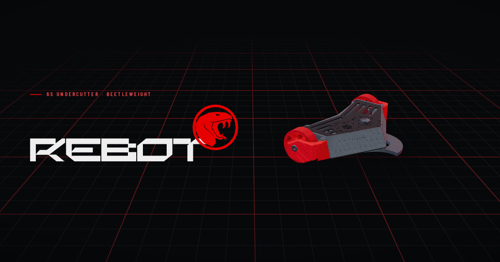
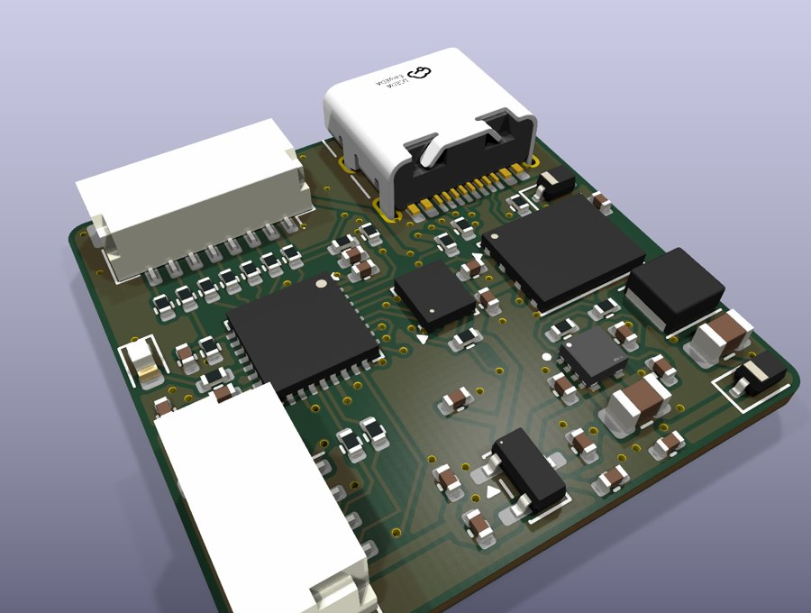
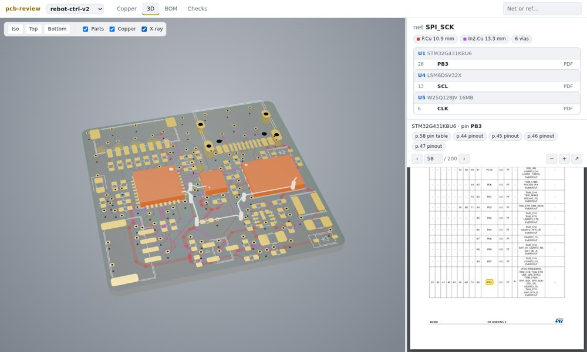

  

  
  
  

 

Hey, I'm Matheus. Computer engineer from São Paulo, software engineer by day, and the guy at the robot event with a
spreadsheet justifying every screw. I write code for a living, and the rest of the time I'm building a robot
whose only job is to break other robots.

 

I graduated in Computer Engineering at **POLI-USP** at the end of 2024. My thesis was
[Micras](https://github.com/Team-Micras), a competitive micromouse, so yes, my diploma is technically a tiny robot
that solves mazes. Then I went to **Amazon**, where I learned the Leadership Principles well enough that they
ended up as the tenets for my battlebot (more on that below).

Now I'm a software engineer at **[Enter](https://getenter.ai)**. We build AI agents that handle mass litigation
for big legal departments in Brazil, which is about as far from robot combat as it gets. Most of that work is
private, so the rest of this page is about what I do on weekends.

 

**Rebot** is a 3 lb (1.36 kg) undercutter that I'm building for the Brazilian beetleweight circuit. After years of
combat with ThundeRatz, it's the first bot I'm building fully on my own terms, and it started from a question a
friend asked me that I couldn't really argue with:

> *"Combat robots have always been done more as art and self-expression than as engineering."*

So Rebot is my attempt to build one as an engineering project. Every decision has to justify itself, without
cutting corners on function for price, for opinion, or because a teammate swore two teeth on a drum was a great idea.
In a meta full of verticals and chompers, my bet is that a horizontal with enough tip speed still has room.

<table>
<tr>
<td width="50%" valign="top">

#### ⚙️ How it works

- **Drive.** Two iFlight 2207s rewired from delta to wye (~1040 kV, more torque per amp), each shaft pressing
  directly on its wheel's rim: a 10.5 : 1 tangential drive with no gearbox.
- **Weapon.** A 2814, also wye, drives a Ø230 mm Hardox bar through a TPU reverse-ratchet wheel that lasts
  **exactly one fight**. That's on purpose: it slips on hits, so the electronics never see the current spike.
- **Structure.** A 2 mm carbon fibre sandwich pressed onto aluminium standoffs inside a TPU unibody.
- **Brains.** A 25 × 25 mm controller board I designed myself (see the shop below).

</td>
<td width="50%" valign="top">

#### 📜 The tenets

1. **Know why.** If you can't explain why a part is that part, in that material, in that place, go back.
2. **Measure twice, cut once.** The spreadsheet comes before the CAD.
3. **Question the status quo.** "It's too hard" isn't a reason. "It isn't worth it" can be.
4. **Rule of Cool.** Engineering first, but it has to be *um robô do caralho*.

</td>
</tr>
</table>

It has already fought, and it already lost one fight to an XT30 that unplugged itself mid-match. Nothing makes
you want to design your own electronics quite like that.

The site, **[rebot.spinup.fail](https://rebot.spinup.fail)**, is a scroll-driven three.js tour of the real CAD
(drive, weapon, structure), and at the end there's a playground where you steer the bot and drop boxes for it to
shred. It's the thing I'm proudest of on this page. Go play with it.

 

Rebot's tenets made me build tools, and the tools turned into side projects of their own.

**[Eitri](https://github.com/Matheus3007/eitri)** (named after the dwarf who forged Mjölnir) is a design and
simulation suite for spinner weapons that an AI can drive. Give it a text spec (size, mass budget, motor, gearing,
material) and it generates the weapon, computes exact mass and MOI from the B-rep, simulates spin-up and bite,
runs CalculiX FEA for spinning and hit loads, optimizes with optuna, and exports a STEP that's ready for the
waterjet.

<table>
<tr>
<td width="50%" valign="top">

#### 🔌 [pcb-lab](https://github.com/Matheus3007/pcb-lab)

PCBs designed entirely as code. The circuit is plain Python, placement and routing are YAML, and KiCad 10 plus
Freerouting run underneath. Every build gets DRC and custom checks plus renders, and gerbers, BOM and CPL go
straight to JLCPCB. I review results, never the KiCad GUI.

Its first real board is **rebot-ctrl-v2**: 25 × 25 mm, 4 layers, an STM32G431 with an LSM6DSV32X gyro, ELRS/CRSF
in, bidirectional DShot out to a 4-in-1 ESC, its own 65 V buck (so the receiver stops browning out), and flash
that logs the whole fight.
</td>
<td width="50%" valign="top">

#### 🔍 [pcb-review](https://github.com/Matheus3007/pcb-review)

I wanted to review those boards from my phone, so now there's **[review.spinup.fail](https://review.spinup.fail)**.
It's a static web viewer with every copper layer, and when you click a net, the datasheet opens at that pin's page.
It also has a 3D X-ray, the BOM and the checks. You can drop any pcb-lab board folder on it and it gets parsed
right in the browser, with nothing uploaded.
</td>
</tr>
</table>

And **[SpinupCalc](https://matheus3007.github.io/spinupCalc/)**, where it all started: an interactive spin-up
calculator for beetleweight weapons, with motor torque limits, aero drag and bearing losses, integrated step by
step. It's the napkin math behind the numbers above, but with charts.

 

**[spinup.fail](https://blog.spinup.fail)** is where Rebot's design log lives, in English and Portuguese: maker
projects, robots, and everything that broke along the way. Some good places to start:
[the manifesto](https://blog.spinup.fail/posts/combat-art-or-engineering/),
[why aero drag is the real limit on an undercutter](https://blog.spinup.fail/posts/its-dragging-bro/), and
[picking ESCs](https://blog.spinup.fail/posts/about-escs/).

 

  
  Older stuff (ElfViewer, SnackTrack, the uni projects) is still in the repos tab. Still yoyoing, still online since 2001.

